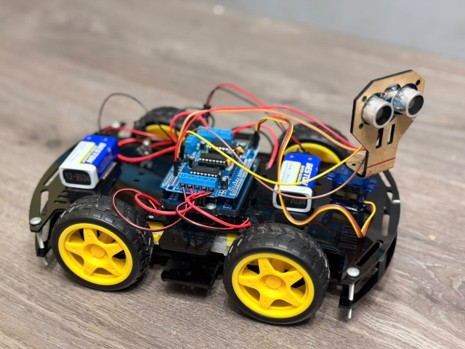
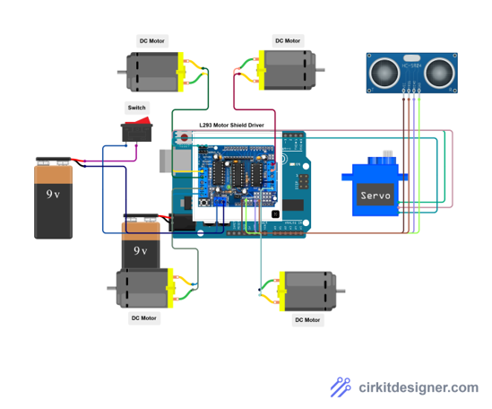

# Arduino-4WD-Obstacle-Avoiding-Robot
An Arduino-based obstacle avoiding robot using an ultrasonic sensor mounted on a servo motor.

## Project Overview
This project is an autonomous Arduino robot designed to detect obstacles and avoid collisions using an ultrasonic sensor.

## Components
- Arduino UNO R3 board
- Ultrasonic sensor (HC-SR04)
- L293 Motor Shield driver
- 4x wheels
- 4x DC motors
- Robot platform 4WD
- 2x 9v Batteries
- Multiple Jumper wires

## How It Works
1. The ultrasonic sensor measures the distance to obstacles.
2. The Arduino processes the distance measurements.
3. When an obstacle is detected, the robot changes direction.
4. The robot continues moving when the path is clear.

## Software
- Arduino IDE
- C/C++

## Libraries
- Adafruit Motor Shield V1 Library 
- Ultrasonic Sensor Library (https://bitbucket.org/teckel12/arduino-new-ping/downloads/)

## Robot

## Wiring

